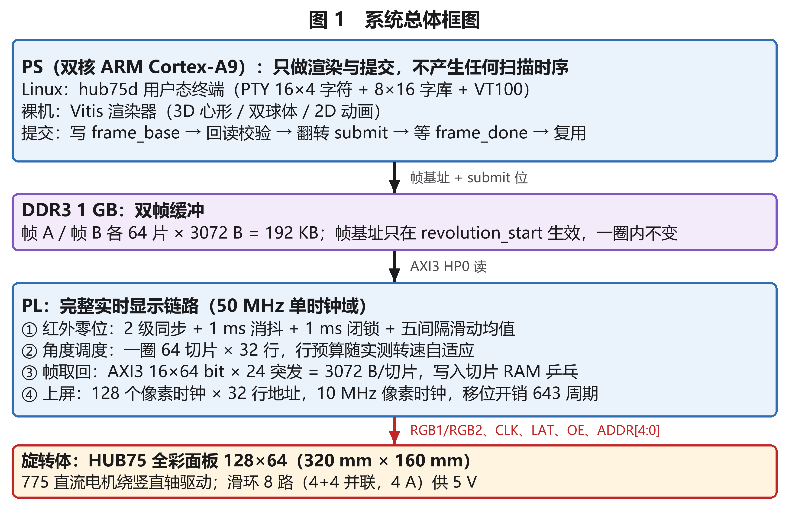
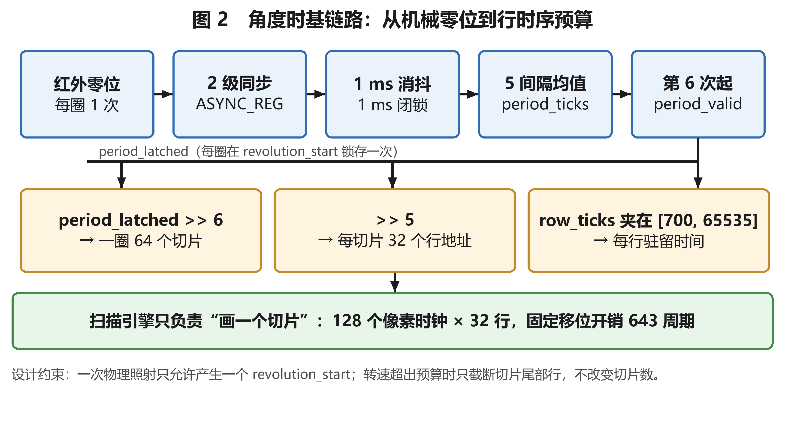
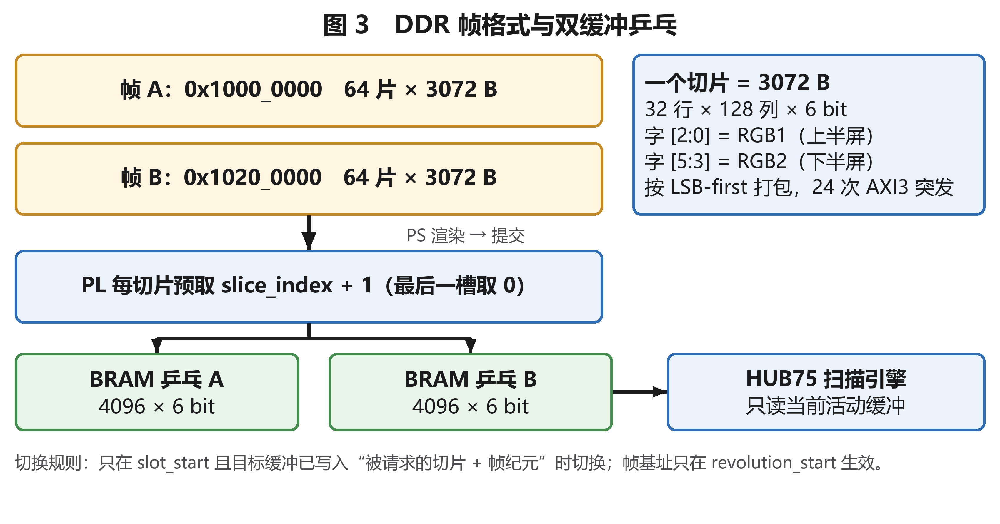

# 基于 7z020 的 3D 体积显示器 · 设计报告

| 项目 | 内容 |
|---|---|
| 竞赛 | 全国大学生嵌入式芯片与系统设计竞赛 2026 · FPGA 创新设计赛道 · 自主选题赛道（初级组） |
| 队伍 | 双缓冲队（团队编号 44483）· 南京理工大学 |
| 队员 | 何钰铭（队长）、冯金奥、游鸿程 |
| 作品名称 | 基于 7z020 的 3D 体积显示器 |
| 目标器件 | AMD Zynq-7000 `XC7Z020CLG400-2`（Mizar-Z7 开发板） |
| 工具版本 | AMD Vivado 2026.1 / Vitis 2026.1（BASIC 许可证） |
| 开源仓库 | https://github.com/llgl0207/hub75_display （MIT） |
| 关键词 | 体积显示 / 自转扫描 / PS+PL 协同 |

## 摘要

本作品用一块 320 mm × 160 mm、128 × 64 的 HUB75 全彩 LED 面板自转扫描空间体积，实现真正意义上的裸眼三维显示。面板固定在 775 直流有刷电机驱动的转台上，每转一圈由定子红外 LED 与转子光电管对齐产生一次零位脉冲；PL 以该脉冲为角度原点，把实测旋转周期切成 64 个切片、每片 32 个行地址，并按周期实时重算每个行地址的驻留时间，从而让扫描节奏始终锁在机械角度上。PS 只负责把下一帧画面渲染进 DDR 并提交，PL 独占红外锁相、DDR 读取、切片缓冲乒乓与全部 HUB75 波形，二者通过一组 AXI GPIO 寄存器握手，形成"主机—显卡"式的解耦。系统已实现 3D 心形、四球跳跃动画、双球体、2D 动画、五种体积特效、打砖块游戏与开机画面，并可在 Linux 用户态把终端文字实时显示在旋转屏上。

**关键数据**：整场扫描率上限 2280 次/秒；一圈 64 切片 × 32 行 × 128 像素；DDR 帧 192 KB、双缓冲乒乓；实现结果 2236 LUT（4.2%）、2746 FF（2.58%）、2 × BRAM36、WNS +5.857 ns、WHS +0.044 ns、DRC 0 违例；RTL 回归 7/7 通过。

---

## 1 选题背景与创新点

### 1.1 要解决的问题

体积显示（volumetric display）与常见的裸眼 3D 有本质区别：后者靠视差屏障、柱透镜或双目视差在**平面**上模拟深度，观看位置或头部姿态一变就会露馅；前者则真的在空间某一区域内逐点发光，形成可环绕观看的三维体素场。

市面上可见的体积显示产品并不多，且普遍分辨率低、由 MCU 驱动。原因在于：**用单块屏幕扫描的方式成像，对刷新率的要求被成倍放大**。设目标为每秒 30 圈、每圈 64 个角度切片、每片 128 × 64 像素，则每秒需要精确刷新

> 30 × 64 × 128 × 64 ≈ 1570 万个体素点

等效 6 bit 数据约 94 Mbit/s，而且每个像素的时序抖动必须小于一个像素时钟（本项目为 100 ns）。这已经超出普通 MCU 的输出能力，也正是本作品选择 FPGA 的根本原因：**PL 可以在单一时钟域内并行地完成计数、移位、行地址推进与像素并串转换，把"刷新率"变成可设计、可约束的硬件参数**。

### 1.2 与已有方案的比较

| 方案 | 做法 | 体素密度 | 成本 | 主要问题 |
|---|---|---|---|---|
| POV 旋转风扇 | 单根/数根 LED 灯带旋转，靠视觉暂留成像 | 极低（只有径向几条线） | 低 | 只适合显示简单图像与文字 |
| 旋转灯带/丝 | 多条竖直灯带围成圆柱 | 低 | 中 | 角度分辨率受灯带数量限制 |
| 静态 LED 立方体阵列 | 三维堆叠 LED | 高 | 很高（N³ 颗灯 + 驱动） | 成本随体积立方增长，难以做大 |
| 光场/全息膜 | 光学调制模拟体素 | 中 | 高 | 视角受限、亮度低 |
| **本作品：单面板旋转扫描** | 一整块 128 × 64 面板作为扫描平面 | 中高（64 × 128 × 64 个体素槽位） | 低（面板 85 元、电机 15 元） | 需要机械配平与角度锁相 |

本方案的关键取舍是：**不按角度定制灯带，而是复用一块量产的 HUB75 面板**。一块 128 × 64 面板提供 8192 个像素，转一圈就把这 8192 个像素分配到 64 个角度切片上，等效得到 64 × 128 × 64 = 52 万个体素槽位，而硬件成本与一整块平面屏相同。代价是必须自己解决两个平面屏不存在的工程问题：机械配平，以及角度与扫描的严格锁相。

### 1.3 三条创新点

1. **单面板旋转扫描的体积成像结构**。以量产 HUB75 面板作扫描面，用"面板在轴线上"的非偏心设计替代常见的"面板偏移 + 配重"方案，避免轴线附近出现扫描死区（见 7.3）。
2. **PS 只渲染、PL 独占实时**的显卡式划分。PS 侧（Linux 或裸机）只往 DDR 里画下一帧，PL 侧独占红外锁相、切片调度、DDR 读取与全部 HUB75 时序，主机调度抖动完全不进入扫描路径。
3. **一圈一锚点的角度时基**。每圈一次红外零位脉冲、固定 1 ms 消抖 + 1 ms 闭锁、五个完整间隔滑动平均，把"机械转速不精确"转变成"数字时基可预测"，并在每个零位处强制回到第 0 切片。

---

## 2 设计原理与功能框图

### 2.1 总体架构



系统分为旋转端与固定端两半。旋转端是面板与光电管，随转台转动；固定端是 Zynq 开发板、红外 LED、滑环、电机与电源。面板的 19 根 HUB75 信号线经滑环上到转台，PS 侧的控制台复用一个 UART。

Zynq 内部按"主机 + 显卡"划分：

- **PS（双核 Cortex-A9）**：运行 PetaLinux 用户态程序 `hub75d`，或运行 Vitis 裸机渲染器。它只做一件事——把一帧体积数据画进 DDR，然后提交。
- **PL**：红外同步与消抖、周期估计、切片调度、DDR 读取、切片 RAM 乒乓、HUB75 波形发生，全部跑在 FCLK_CLK0 的 50 MHz 单时钟域内。
- **DDR3 1 GB**：帧 A（`0x1000_0000`）与帧 B（`0x1020_0000`）双缓冲，每帧 64 片 × 3072 B = 192 KB。

之所以强调"显卡"这个类比，是因为两者的数据流方向完全一致：主机准备好画面 → 通过寄存器告知显存地址 → 显卡按自己的时序把画面刷到显示器上 → 主机等垂直同步再换下一帧。本项目把"显存地址"换成 `frame_base`，把"垂直同步"换成 `frame_done`，把"显示器时序"换成 HUB75 的行/场时序，其余逻辑一一对应。

### 2.2 角度时基：把机械误差变成数字可预测量

体积显示最怕的不是转速快慢，而是**转速在变**。如果扫描按固定节拍推进，而机械转速在某次上电后略有不同，图就会慢慢转斜、撕裂。本项目的做法是让扫描节拍永远跟着机械走：



1. **零位检测**：定子装红外 LED，转子装光电管，转到零位时二者对齐产生一次电平跳变，每圈恰好一次。LED 采用沉头安装，使对齐角度窗口尽量小，触发点更锐利。
2. **输入调理**：2 级同步（`ASYNC_REG`）后进入固定 1 ms 消抖窗口——电平必须连续保持 1 ms 才被接受，窄脉冲与接触抖动直接丢弃；接受后再进入 1 ms 闭锁窗口，期间输入被忽略，防止"一次照射产生多个边沿"。这两个窗口都是综合期参数（`IR_DEBOUNCE_US`、`IR_HOLDOFF_US`），不做自适应。
3. **周期估计**：取最近五个完整间隔的算术平均。时间戳记在**被接受的边沿**上而不是"接受时刻"，因此 1 ms 消抖延迟不会混入周期估计（它只是给所有边沿加了一个固定相位偏移，可一次性标定）。
4. **调度**：在每次 `revolution_start` 锁存周期，并把切片号强制归零（`hub75_sched`）。周期右移 6 位得到"每切片时钟数"，再右移 5 位得到"每行驻留时钟数"，全程只用移位、不实例化除法器。

这样做的结果是：无论电机转多快，图始终以零位为起点、按当圈实测周期匀速铺满 360°。

### 2.3 切片、帧格式与双缓冲



- **一片 = 3072 B**：32 个行地址 × 128 列 × 6 bit。其中每列的 6 bit 拆成两个半屏：`[2:0]` 送 RGB1（上半屏），`[5:3]` 送 RGB2（下半屏），按 LSB-first 紧凑打包。
- **一帧 = 64 片 = 192 KB**，对应一圈 64 个角度方向。
- **乒乓**：PL 在每一个切片槽里预取"下一片"（`slice_index + 1`，最后一槽取 0）写入扫描不读的那块 BRAM，在下一个 `slot_start` 才切换读缓冲。切换条件是"目标缓冲已写入被请求的切片且帧纪元匹配"，因此不会读到半成品。
- **帧交接**：PS 写 `frame_base` → 回读确认 → 翻转 `submit` 位；PL 只把它存为 pending，**真正的生效点是 `revolution_start`**，一圈内绝不改基址；换帧时 `frame_ack` 与 `frame_done` 同时翻转，PS 见到翻转后才复用旧缓冲。

一条硬性约束写在源码注释里：**预取目标不能写成"当前切片已在缓冲里就跳过"**。早期版本这样写过，结果首帧把当前切片填满后，没有任何缓冲持有下一片，读缓冲永远切不出去，扫描读到空 BRAM，表现就是"黑屏 + `buf_ready=0`"。

### 2.4 扫描引擎与时间预算

扫描引擎只做一件事：按给定行预算画好一个切片。

- 每行 128 个像素时钟，每个像素在 50 MHz 下占 5 个时钟（`PIXEL_CYCLES = 1 + 2 × PIXEL_HALF_DIV`，`PIXEL_HALF_DIV = 2`），即 10 MHz 像素时钟；
- 每行固定开销 643 个周期（`ROW_OVERHEAD = 128 × 5 + 3`），这是移位寄存器把 128 列推满所需的不可压缩时间；
- 每个切片 32 个行地址，行预算 `row_ticks` 由调度器按实测周期给定并夹在 [700, 65535] 之间。

由此得到转速—预算关系：

| 转速 | 一圈周期 | 每切片 | 每行驻留 | 整场扫描率 |
|---|---|---|---|---|
| 600 RPM（PS 版默认回退） | 100 ms | 1.5625 ms | 48.8 µs | 640 次/秒 |
| 1800 RPM（PL 单独测试镜像） | 33.3 ms | 520.8 µs | 813 cycles（16.3 µs） | 1920 次/秒 |
| 面板/线材上限 | — | — | — | 2280 次/秒（⇒ 约 2138 RPM） |

当转速升高、`row_ticks` 触到下限 700 时，32 行将无法在一个切片内画完，此时唯一允许的退化是**截断该切片最后几行**，而不改变切片数——这条约束保证了"角度分辨率"永远是优先指标。

---

## 3 软硬件划分依据与接口设计

### 3.1 划分原则

划分依据只有一条：**谁是硬实时的，谁就进 PL**。

HUB75 的 CLK/LAT/OE/地址/RGB 必须严格等间隔输出，任何一次调度抖动都会直接表现为亮度跳变或画面撕裂；而体积显示又要求这些输出与机械角度连续对齐。相比之下，渲染一帧 192 KB 的数据、跑一个终端模拟器、甚至跑一个操作系统，都可以容忍毫秒级延迟。因此：

- PL 拥有：红外捕获、周期估计、切片调度、DDR 读取、切片 RAM 乒乓、全部 HUB75 波形、帧切换时机；
- PS 拥有：画面生成（3D 几何、字体、特效、终端解析）、帧提交协议、状态监控、人机交互。

PS **从不**产生像素时钟，**从不**参与每切片事件。这条边界在 Linux 版跑通后得到验证：即使 Linux 调度、SSH、键盘中断同时发生，面板时序也不受任何影响。

### 3.2 PS 侧实现

**裸机渲染器（`sw/renderer/main.c`）**：不依赖 BSP 的控制台初始化（手写 SLCR 把 MIO48/49 切到 UART1、配好波特率分频），上电后先关 D-Cache、对帧 A/B 各 2 MiB 做两轮 `0xA5A5A5A5` 与递增模式自检、打印 `DDR PASS`，再开 Cache 进入渲染。内置三种画面：3D 心形（64 个角度切片、红体/洋红顶叶/白边）、双球体（左红右绿）、2D 静止动画（64 片同图、20 fps）。三角函数用 64 点 Q15 查表代替 libm。

**Linux 用户态（`sw/linux/hub75d.c`）**：把 PTY 上的字符流变成体积画面。16 × 4 字符窗口、8 × 16 点阵字库、VT100 状态机支持 `CSI H/f/J/K/A-D` 与 `RIS`，足够跑 busybox ash。只依赖 `/dev/mem` + `mmap`，无内核模块、无 UIO；计时用手读全局定时器寄存器（内核 4.14 上 glibc 的 time64 系统调用返回 `ENOSYS`，故避开 `clock_gettime/usleep/select`）。另有五种体积特效（blackhole / fireworks / vortex / knot / tunnel，128 × 128 × 64 体素网格光栅化后按 64 切片采样）与打砖块游戏。

### 3.3 PS ↔ PL 寄存器契约

| 方向 | 地址 | 位域 | 含义 |
|---|---|---|---|
| PS→PL | `0x4120_0000` ch1 | [31:0] | `frame_base`：当前帧在 DDR 的基址 |
| PS→PL | `0x4120_0000` ch2 | [0] | `submit`：提交翻转位（写一次翻一次） |
| | | [1] | `enable`：显示使能 |
| | | [15:8] | 切片数（当前 64） |
| PL→PS | `0x4121_0000` ch1 | [0] | `frame_ack`：提交已被接受 |
| | | [1] | `reader_busy`：DDR 预取进行中 |
| | | [2] | `buf_ready`：至少一块缓冲已有有效数据 |
| | | [3] | `frame_done`：换帧完成（翻转位） |
| | | [4] | `ir_active`：超时窗口内出现过红外边沿 |
| | | [5] | `pending_valid`：存在待生效的帧基址 |
| | | [6] | `active_valid`：当前帧基址已生效 |
| | | [7] | `enable`（PL 侧采样值） |
| | | [13:8] | 当前活动切片号 |
| | | [23:16] | 帧序号 |
| | | [31] | `period_valid`：周期估计已有效 |
| PL→PS | `0x4121_0000` ch2 | [31:0] | `period_ticks`：当圈实测周期（50 MHz 时钟数） |

**一次完整提交的时序**：

```
PS: 渲染完成 → 刷 Cache(192 KB) → 写 frame_base → 回读确认 → toggle submit
PL: 锁存 pending → 等下一个 revolution_start 生效 → 逐切片预取 → frame_done 翻转
PS: 轮询到 frame_done 翻转 → 该缓冲可安全复用
```

### 3.4 三个接口决策

1. **用 AXI GPIO 而不是自定义 AXI-Lite 外设**。控制面只有 4 个 32 位寄存器，AXI GPIO 免去写 IP、打包、维护寄存器映射的成本；代价是位域语义要靠软件约定，因此把完整位表写进了 `sw/PS_DEVELOPER_GUIDE.md`。
2. **DDR 读取走 S_AXI_HP0 的 AXI3 主机**。Zynq-7000 的 HP 口是 AXI3，突发上限 16 beats；一片 3072 B 正好拆成 24 次 16 × 64 bit 突发。读取使用 `ARCACHE = 4'b0010`（device，非 cacheable），直接绕开 PS 与 PL 的缓存一致性问题——这也是 Linux 版最终能稳定跑通的关键改动之一。
3. **帧基址必须做合法性检查**。PL 的 GP0 互连只映射了帧 BRAM 区域，若 PS 因两路 GPIO 写序错乱而提交了 0 或野地址，reader 会发起一次到未映射地址的 AXI 读，直接挂死 GP0 总线并触发看门狗复位。现在 reader 在 `[0, 0x1FFF_FFFF]` 之外直接拒绝。

---

## 4 优化过程与性能资源对比

### 4.1 逐步增量

| 构建 | 内容 | LUT | FF | BRAM | WNS (ns) | WHS (ns) | 状态 |
|---|---|---:|---:|---:|---:|---:|---|
| 红外捕获模块单独综合 | 同步 + 消抖 + 锁存 + 五间隔均值 | 657 | 339 | 0 | +9.207 | +0.037 | 综合/优化 |
| PL 单独板测镜像 | 静态扫描 + 红外 + UART + 调度闭环 | 959 | 678 | 0 | — | — | 已生成 bit，板上验证 |
| PS Stage 0 | 仅 PS7（UART0/1 + DDR3 + FCLK） | 0 | 0 | 0 | 无用户路径 | 无用户路径 | 板上验证 |
| **PS Stage 1（交付版）** | PS7 + AXI GPIO + HP0 + DDR reader + 切片 RAM + HUB75 | **2236** | **2746** | **2** | **+5.857** | **+0.044** | 板上验证 |

数据来源：`data/logs/ir_standalone/`、`data/logs/pl_board_test/`、`data/logs/ps_stage0/`、`data/logs/ps_stage1/`（Vivado 2026.1 生成，器件 `xc7z020clg400-2`，设计 `system_top`，DRC 0 违例）。

从 657 LUT 到 2236 LUT 的增长主要来自三处：切片驱动的扫描引擎与调度器（+约 300 LUT）、AXI3 读主机与 6 bit 解包器（+约 700 LUT）、以及 PS7/互连带来的胶合逻辑。资源占用始终低于器件的 5%，说明本设计的天花板不在逻辑规模，而在**面板扫描率与机械转速**。

### 4.2 四个关键取舍

1. **一圈 64 切片**。这是在"面板最大整场扫描率（2280 次/秒）"、"可接受的角度颗粒感"与"最小体素密度"三者之间取的交点：64 片在 600–1800 RPM 下都还能保证每行有足够驻留时间（> 700 周期），再往上加切片，行预算会先撞到下限。
2. **回退转速 1800 RPM（PL 镜像）/ 600 RPM（PS 版）**。回退值的作用是让面板在没有红外信号时也能扫描，便于开机自检。早期我们误以为 2280 次/秒顶格会"锁不住移位寄存器"，实测表明问题根源更多与**供电电压跌落**有关，而不是帧率本身；这一判断修正后，回退转速只是演示便利，不再是性能限制。
3. **BRAM 乒乓而不是直读 DDR**。DDR 随机访问的延迟不可控，扫描若直接读 DDR，亮度会随总线竞争抖动。改成"每切片预取到 BRAM、扫描只读 BRAM"后，扫描路径与 AXI 总线彻底解耦。一片 3072 B 在 50 MHz 下约需 100 µs，远小于 600 RPM 时的 1.56 ms 切片预算。
4. **先裸机、后 Linux**。裸机链路短、可观测，先把 PS7/UART/DDR/AXI 全部打通，再上 Linux，避免"操作系统问题"与"硬件问题"混在一起排查。这个顺序在后来的供电问题排查中救了大忙。

### 4.3 实测数据

| 指标 | 数值 | 说明 |
|---|---|---|
| 整场扫描率 | 上限 2280 次/秒 | 受 HUB75 面板与排线限制，实测上限附近可稳定显示 |
| 切片数 / 每切片行数 | 64 / 32 | 可综合期修改（`SLOT_LOG2`、`ROW_LOG2`） |
| 像素时钟 | 10 MHz | 由 50 MHz 五分频 |
| 实现时序 | WNS +5.857 ns / WHS +0.044 ns | 50 MHz 时钟，无失败端点 |
| 资源 | 2236 LUT / 2746 FF / 2 BRAM36 / 21 IOB | 较整片器件占用 < 5% |
| DDR 帧容量 | 192 KB / 帧，双缓冲 | 单帧 64 片 × 3072 B |
| 显示效果 | 3D 心形、四球跳跃动画、2D 动画、5 种体积特效、打砖块、Linux 终端、U-Boot 开机画面 | 均已在旋转面板上实机观察 |
| 功耗 | 数字部分 + 面板 < 10 W；电机 5 V 约 30 W | 万用表粗测 |
| RTL 回归 | 7 / 7 testbench PASS | `sim/run_regression.tcl` |
| 实际转速、DDR 带宽、连续运行时长 | **待测** | 见 4.4 |

### 4.4 已知局限与待完成

如实列出尚未解决的问题，这些也是下一阶段的开发清单：

1. **转速与闪烁未定量**。目前"最高转速多少、此时闪烁感如何"只有主观感受，缺少转速计与高速相机数据。按设计预算，转速上限约 2138 RPM（对应 2280 次/秒），需要实测确认。
2. **体素密度不均衡**。体积显示的清晰度受"木桶效应"支配：体素在径向、切向、轴向三方向的间距中，**最稀疏的那个方向**决定整体画质。当前 64 个角度切片使得切向间距明显大于屏幕自身的像素间距，因此加大切片数（并把面板扫描率、DDR 带宽同步提上去）是提升画质的主线；理想状态是三个方向的体素间距接近 1:1:1，否则在某一方向做更细的划分没有意义。
3. **容量与镜像未做满**。设计容量的目标是每半圈 400 片、后半圈通过镜像复用，当前实现是 64 片独立切片、不做镜像。
4. **首圈缺片与接缝行**。每个新帧生效的第一圈，第 0 片尚未预取完成，会出现一次短暂缺片；另外 PL 对 `row_addr = 0` 关闭 OE 以消除顶部鬼影，因此顶部与接缝各会空出一行。个别动画在面板顶部偶见一次性残影，属间歇现象，尚未定位。
5. **DDR 频率仍是 400 MHz**。已按 533.333 MT/s 预留，但因未做长时间 memtest 而保持保守值。
6. **无线控制未实现**。最初的需求里有手机/上位机无线投送画面，当前只做到 UART 控制台与本地渲染，无线作为后续扩展。

---

## 5 大模型协作记录

本作品的全部 RTL、脚本、文档与调试过程均在 AI 编码助手（DeepSeek Harness 客户端，模型 deepseek-v4.1-flash；辅助使用 Claude Code）协作下完成。完整对话已导出到 `AI对话聊天记录/`（10 个会话、约 450 条人类提示词），其中 `_prompts.md` 为逐字提示词记录。

### 5.1 协作模式

队伍的协作套路可以概括为三步：**先给物理约束 → 让 AI 出方案 → 用实测证伪**。例如：

- "硬件时序参数已经用 H7 测完，FPGA 只需要按约定输出时序，我更想确定的是开发流程"——先划清边界，避免 AI 从零猜时序；
- "板卡的引脚定义详见 <厂商手册链接>，输出接线应该仅限于 JP1 和 JP2"——把不确定的物理事实交给资料，而不是让模型编。

AI 侧则被要求：不虚构实测结果，未验证项一律标 TBD，每个改动给出可复现命令与预期输出。这条纪律在报告中体现为 4.3 与 4.4 两张表的区分。

### 5.2 典型提示词（原文）

> "我需要做一个体积显示器，需要用 fpga 驱动 hub75 屏幕，同时需要做画面渲染，还需要无线控制，怎么规划软件架构，MIZAR R7 XC7Z020"

> "我现在要从零入门 fpga 并在短时间内完成整套系统的开发，我认为第一步是打通 HUB75 协议的 PL 输出。怎么规划开发路径"

> "时序约定已加入工作区，下一步是如何从新建工程开始"

> "我已创建工程，从第四步起，你能否调用工具完成创建或者使用 mcp/tcl 命令实现自主完成"

这组提示词体现了本项目的真实起点：队伍此前没有 FPGA 工程经验，靠"先打通一条最小链路，再逐段加长"的方式推进。

### 5.3 自我纠错轨迹

以下四次纠错都被记进了项目文档，也是技能包的素材来源：

1. **ILA 被许可证挡住**。最初方案依赖集成逻辑分析仪观察内部信号，Vivado 报 `create_debug_core failed`（BASIC 许可证不覆盖）。改为"LED + UART 报文 + USERID 读回"三件套后，反而建立了不依赖调试核的客观证据链。
2. **把供电问题误判成软件问题**。Linux 阶段出现"运行一段时间后复位"，一度怀疑看门狗、AXI 总线、内核版本。最终定位是**电池供电跌落触发 POR**，换电池后全部现象消失。教训被写进交接文档：先量电压，再改代码。
3. **中文 Windows 下的工具链编码崩溃**。Vitis Python API 在 `vitis.create_client()` 处报 `utf-8 codec can't decode byte 0xd5`——它按 UTF-8 读取本机子进程输出，而中文版 Windows 的代码页是 GBK。解决方式是在批处理里 `chcp 65001` 并设置 `PYTHONUTF8/PYTHONIOENCODING`，该修复已固化进 `build/run_build_sd_boot.bat`。
4. **HP0 缓存属性导致死锁**。Linux 下写帧后 PL 读到的是旧数据，一度以为缺 cache flush；真正原因是 HP0 的 `ARCACHE` 被设为 cacheable，与 PS 的 D-cache 打架。改成 `4'b0010`（device, non-cacheable）后，用户态只需 `__sync_synchronize` 即可。

### 5.4 AI 的能力边界

队伍对 AI 的定位很清楚：它能读代码、能写脚本、能推演时序，但**接触不到显示器、配平、电压与纹波**。这几项只能靠人观察现象、凭经验推断、再用仪器验证。因此本项目所有"好不好看、平不平、稳不稳"的判断，最终都由队员在实机上拍板，AI 负责把这些判断落成可复现的代码配置。

---

## 6 技能包的提炼过程

技能包位于仓库 `skill/` 目录，共 4 个，均来自本项目真实踩坑，并写明了适用范围、使用方法、失效条件与验证证据。

| 技能包 | 解决什么问题 | 从哪次失败总结 |
|---|---|---|
| `vivado_batch_build` | Vivado 批处理构建的目录隔离、报告归集；`launch_simulation` 报 `Spawn failed` 时改用绝对路径调用 `xvlog/xelab/xsim` | 回归脚本在中文路径与 `PATH` 缺失下反复失败 |
| `zynq_ps7_axi3_hp0` | Zynq-7000 HP0 是 AXI3（≤16 beats）、`proc_sys_reset` 的 `C_AUX_RESET_HIGH` 陷阱、非一致 cache 的读写约定 | AXI4 协议直连报错、A9 首次访问 GPIO 挂死、Linux 读到旧帧 |
| `vitis_2026_headless_sd_boot` | XSCT 在 Vitis 2026.1 被禁用后的 Python 自动化路线；中文 Windows 的 UTF-8 崩溃；FSBL + bitstream + ELF 合成 `BOOT.BIN` | `xsct -eval` 直接报禁用；`vitis.create_client()` 解码失败 |
| `zynq_bringup_evidence_kit` | 无 ILA 时的客观证据链：`DONE/EOS` 判据（`PROGRAM.IS_PROGRAMMED` 不存在）、`USERID` + `REGISTER.USERCODE` 自证构建来源、LED/UART 观测 | BASIC 许可证无调试核，需要证明"板上跑的是哪次构建" |

**提炼方法**：先把踩坑按"触发条件—现象—排查步骤—根因—修复"结构化记录（原始素材在 `report/handover.md` 与 `report/ai_collaboration.md`），再抽象成与本队题目无关的通用步骤，最后用"换一块板/换一个题还能不能用"作为筛选标准——只有能迁移的才留下。

**边界说明**：这四个技能包都**不**依赖本项目特有的旋转扫描算法，适用于任意 Zynq-7000 + Vivado/Vitis 2026.1 的工程；反过来，本项目特有的"红外锁相 + 切片调度"没有写成技能包，因为它与体积显示题目强绑定，复用价值低。

---

## 7 复现说明

### 7.1 环境

- Windows 主机 + AMD Vivado 2026.1（含 XC7Z020 器件支持）与 Vitis 2026.1；
- Zynq-7000 开发板（本项目使用 Mizar-Z7，`xc7z020clg400-2`）；更换板卡需重新核对引脚约束与 I/O 电平；
- 128 × 64 / 1：32 扫描的 HUB75 面板一块、775 直流有刷电机、8 路滑环、红外对射器件、3D 打印夹具与铝型材转台；
- microSD 卡（MBR + FAT/FAT32）用于脱机启动。

### 7.2 四条命令

```powershell
# 1. RTL 回归：7 个 testbench 全 PASS 打印 REGRESSION_COMPLETE
vivado -mode batch -source sim/run_regression.tcl

# 2. PL 单独上板镜像（不依赖 PS，用于面板/时序自检）
vivado -mode batch -source build/build_board_test.tcl

# 3. PS+DDR 完整系统的比特流与 XSA
.\build\vivado.ps1 build\build_ps_system.tcl -TclArgs 1

# 4. 生成 SD 卡脱机启动镜像 BOOT.BIN（FSBL + bitstream + ELF）
.\build\run_build_sd_boot.bat
```

每步的预期输出标记分别为 `REGRESSION_COMPLETE`、`BOARD_TEST_BUILD_COMPLETE`、`PS_SYSTEM_BUILD_COMPLETE`、`BOOT.BIN`（约 4.2 MB）。Vitis 的图形化建工程步骤见 `sw/README.md`。

### 7.3 机械复现要点

机械部分最容易卡住，几个关键点：

1. **屏幕必须位于轴线上**。常见做法是把面板偏移安装、再在另一侧加配重，但那样轴线附近会形成扫描死区（屏幕扫不到的区域），对显示不利。本作品采用非偏心设计：面板中心与转轴重合，配重块只用于消除残余不平衡。
2. **配平方法**：先用垂线确定轴线与重心位置，再在实际运行时观察抖动，逐次微调配重。
3. **上下轴必须垂直对齐**。若上下轴承的平行度不足，旋转过程中转子会产生周期性形变。可让一侧（如底座侧）采用非紧固的连杆式连接而非刚性锁死，给形变留出自由度。
4. **触发角度要小**。红外 LED 沉头安装，使"对齐窗口"尽量窄，零位更锐利；同时因为转子惯量大、转速稳，实际对齐效果良好。

### 7.4 常见卡点

| 现象 | 排查方向 |
|---|---|
| 面板全黑、`buf_ready=0` | 帧基址未生效或预取未完成；检查 `frame_ctrl` 的 enable/submit 与 `status` |
| 反复重启 | **先量供电电压**；POR 供电跌落会伪装成"软件崩溃" |
| PS 卡死、看门狗复位 | 提交了未映射的 `frame_base`，AXI 读挂死 GP0 |
| Linux 下画面不动 | HP0 `ARCACHE` 是否设为非 cacheable；用户态写完是否 `__sync_synchronize` |
| 顶部/接缝出现异常行 | `row_addr = 0` 的 OE 处理与面板首行硬件特性 |

---

## 8 团队分工与成本

| 成员 | 分工 |
|---|---|
| 何钰铭（队长） | 总体设计走向、FPGA 起步设计、机械打印件、配平方案、电源树设计、文档与视频编排 |
| 冯金奥 | 电源树设计、电源制作、FPGA 后期开发、方案敲定 |
| 游鸿程 | 机械主体设计、型材框架搭建 |

| 项目 | 数量 | 单价（元） | 小计（元） |
|---|---|---|---|
| Mizar-Z7 开发板 | 1 | 约 1831 | 1831 |
| HUB75 面板（128×64，320×160 mm） | 1 | 85 | 85 |
| 775 直流有刷电机 | 1 | 15 | 15 |
| 8 路滑环 | 1 | 20 | 20 |
| 铝型材框架 | 1 套 | 300 | 300 |
| 3D 打印件 | — | 10 ~ 20 | 20 |
| 电源 | 1 | 未单独计 | — |
| **合计** | | | **约 2271（不含电源）** |

---

## 附录 A　提交物与文件对照

| 《选题指南》要求 | 本仓库对应位置 |
|---|---|
| 完整源码（RTL / PS 软件） | `src/`（9 个 Verilog 模块）、`sw/`（裸机渲染器、Linux 用户态、公共帧库） |
| 仿真或验证结果 | `sim/`：7 个 testbench + `run_regression.tcl`，脚本会逐个核对 PASS 行与 `$fatal` |
| 综合与实现报告 | `data/logs/` 下 `pl_board_test/`、`ps_stage0/`、`ps_stage1/`、`ir_standalone/` 各自的 timing / utilization / drc / cdc / io |
| 上板工程、运行脚本、实测输出 | `board/`（约束、bit、XSA、板测流程）、`data/`（实测记录与 UART 原始日志）、`build/*.tcl`、`build/*.ps1` |
| 可复现构建脚本 | `build/build_board_test.tcl`、`build/build_ps_system.tcl`、`build/build_sw.py`、`build/build_sd_boot.py` |
| 技能包 | `skill/`（4 个技能包 + README） |
| 设计报告与大模型协作记录 | 本文件、`report/ai_collaboration.md`、`report/handover.md`、`AI对话聊天记录/` |

> 说明：本报告中的资源与时序数据均取自仓库内 `data/logs/` 的 Vivado 原始报告；未实测项目一律标注"待测"，不以估算值代替。
